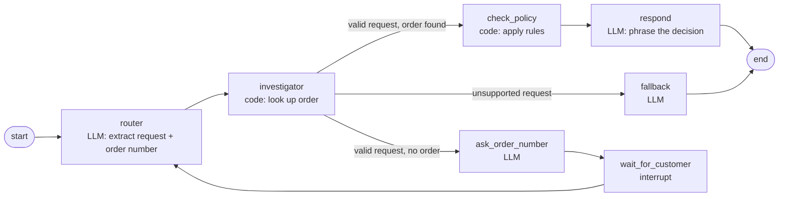

# ReturnDesk 

A customer support bot for two requests: **returning an item** and **replacing one that arrived damaged**.

An LLM understands the customer and writes the replies. **Plain code makes every eligibility decision**,
so a customer cannot talk the bot into an exception.

## How it works



## Design decisions

- **Rules are code, not prompts.** `policy.py` is deterministic and unit-tested.
- **The model only phrases decisions.** `respond` is given a decision and a fixed meaning for it, and is told not to go beyond it.
- **Pause and resume.** If the order number is missing, the graph pauses with `interrupt` and resumes with the customer's reply, using checkpointed state.
- **One model per job.** The router runs at temperature 0, the writer at 0.3 (`config.py`).
- **Tests need no API key.** Rules, routing, and data lookups are plain Python.

## Project layout

```
support_bot/
├── graph.py     wiring: nodes and edges
├── nodes.py     every node
├── routing.py   conditional-edge decisions
├── prompts.py   every prompt
├── state.py     shared state
├── schemas.py   structured output the router model returns
├── config.py    models and supported request types
├── policy.py    business rules
└── orders.py    mock order backend
tests/
main.py          chat in the terminal
```

## Run

```
python -m pip install -r requirements.txt
copy .env.example .env
python main.py
python -m pytest
```

Try: `My fridge arrived broken`, then `it's 1009`.
Sample orders: `1009` (delivered 30 days ago) and `1010` (delivered 4 days ago).


