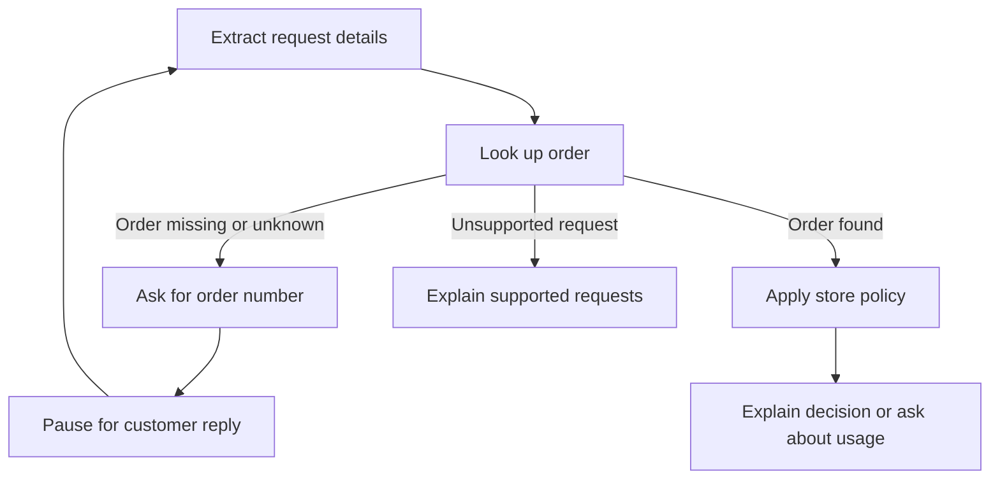

# ReturnDesk

**A customer support assistant for returns and damaged-item replacements.**

A customer can describe the problem in their own words. ReturnDesk finds the order, asks for missing details, and explains whether the request meets the store's policy. A language model interprets messages and writes replies; Python decides eligibility.

Built with **Python · LangGraph · LangChain · OpenAI · pytest**.

## See it in action

A standard return with both the order number and item condition missing. The bot's wording may vary.

```text
You: I'd like to return an item.
Bot: What's your order number?
You: 1009
Bot: Has the fridge been used?
You: No, it hasn't been used.
Bot: Your fridge is eligible for a return.
```

Start a fresh session and try: **“The headphones in order 1010 arrived damaged. I'd like a replacement.”** The sample order is within the replacement window, so the bot should report that it's eligible.

| Request | Demo store policy |
| --- | --- |
| Standard return | The item must be unused and reported within 30 calendar days of delivery. |
| Damaged-item replacement | The damage must be reported within 14 calendar days of delivery. |

Both deadlines include the final day. Order **1009** is a fridge delivered 30 days ago; order **1010** is a pair of headphones delivered 4 days ago. The demo calculates those dates when the app starts.

## How the workflow works



- **Structured input:** The model extracts the request type, order number, and whether the item was used. The workflow uses those fields to choose its next step.
- **Rules in Python:** The policy code checks delivery dates and item usage. The reply model receives the result and explains it to the customer.
- **Conversation state:** A missing or unknown order number pauses the graph until the customer replies. If the policy needs the item's usage status, the next CLI message uses the same thread, so the customer can answer without repeating the order number.

## Run locally

You’ll need Python and an OpenAI API key for the interactive demo. Python 3.12 is a good starting point.

```powershell
git clone https://github.com/AmarMo0/ReturnDesk.git
cd ReturnDesk
python -m venv .venv
.\.venv\Scripts\Activate.ps1
python -m pip install -r requirements.txt
Copy-Item .env.example .env
```

On macOS or Linux, use `python3 -m venv .venv`, activate with `source .venv/bin/activate`, and copy the template with `cp .env.example .env`.

Set `OPENAI_API_KEY` in your local `.env`, then run:

```shell
python main.py
```

Type `exit` or `quit` at the main prompt to close the app. Restart it to try a separate case.

## Run the tests

```shell
python -m pytest
```

The tests cover policy decisions, routing, order lookup, and policy outcome descriptions. They don’t call the model or need an API key.

## Where to look in the code

| File | Responsibility |
| --- | --- |
| [`main.py`](main.py) | Runs the terminal chat and passes replies back to the graph. |
| [`agent/graph.py`](agent/graph.py) and [`agent/routing.py`](agent/routing.py) | Define the workflow and choose its next branch. |
| [`agent/nodes.py`](agent/nodes.py) and [`agent/state.py`](agent/state.py) | Handle each workflow step and track information across turns. |
| [`agent/policy.py`](agent/policy.py) and [`agent/orders.py`](agent/orders.py) | Apply the store rules and look up sample orders. |
| [`tests/`](tests/) | Checks for policy rules, routing, sample orders, and outcome descriptions. |

This is a CLI prototype with sample orders and in-memory conversation state. It checks eligibility only; it does not submit returns, issue refunds, or arrange replacements.
